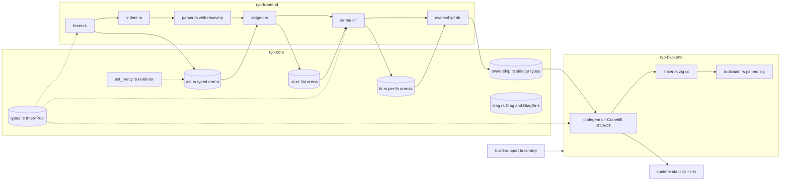

**Status:** Complete (codebase snapshot 2026-08-24, branch `fix/file-length-gate` @ `333dbca`)

# Architecture Analysis — 2026-08-24

Refresh of the 2026-08-20 snapshot (`c24a224`, branch `fix/i-089-param-mode-decode`; previous snapshots were deleted — see git history). Every module was re-verified at HEAD; claims from the previous analysis are marked **fixed**, **open**, or **stale**. Issue references (`I-xxx`) point to [ISSUES.md](../../ISSUES.md); resolved entries are removed from that file, so resolved work is described inline rather than cited.

The delta splits in two: `main` landed #114 (strict `ParamMode` decode), #115 (integer div/mod-by-zero guards), #116 (parser-recovery block-header fix), #117 (AST flattened into a typed arena), and #118 (hot-path bookkeeping removal + lint-policy tightening); the snapshot branch then executed the §4 file-length plan from the previous analysis almost verbatim: `ownership.rs`/`sema.rs`/`codegen.rs` became module directories, `integration_tests.rs` became six per-area test binaries, and a file-length gate now runs locally (`scripts/check_file_length.sh`) and in CI (`tidy` job) with **no allowlist** — initially 3000 lines, tightened to **2000** the same day after the views-test split and `tir.rs` test extraction.

Scale: ~36.5k lines of Rust source across 7 workspace crates, ~860 `#[test]` (previous snapshot: ~29k lines, 811 tests). A macOS `cargo test --workspace` run at HEAD: **828 passed, 0 failed** (valgrind smoke suite skips without valgrind installed).

---

## 1. Crate Map & Pipeline

Dependency direction remains acyclic: `ryo` (CLI) → `ryo-driver` → `ryo-frontend` + `ryo-backend` → `ryo-core`. The pipeline keeps the full M8.1+ shape (ownership between sema and codegen, positional sidecar). Structural change since the snapshot: the three largest compiler files are now module directories, and the AST is a typed arena (#117), not a Box tree.

| Crate | Files (lines) | Role |
|---|---|---|
| `ryo-core` | tir 1612 (+ tir/views 366, tir/layout_docs 138; tir/tests 309), uir 1612 (+ uir/views 394, uir/layout_docs 155), ast 1596 (+ ast/stmts 236, ast/inspector 48), types 892, ast_pretty 503, diag 347, ownership 112, errors 69 | IRs, AST arena, InternPool, diagnostics, sidecar types |
| `ryo-frontend` | parser 921 (+ statements 939), lexer 1014, astgen 1379 (+ astgen/tests 584), indent 287, builtins 233; **sema/** = expr/mod 1373 (+ expr/methods 184, expr/operators 432), mod 742, tests 1374 (+ tests_borrows 237, tests_str_views 402), stmt 521, builtins 501, call 272; **ownership/** = mod 1318, walk 1503, loops/mod 1419 (+ jumps 430), views 1033, frees 351, merge 346, diag_fmt 55, exit_frees 766, tests 11834 (21 files) | source → TIR + ownership |
| `ryo-backend` | **codegen/** = expr/mod 1650, mod 1583, function_context 365 (+ expr/fat_slot 273); toolchain 269, runtime_lib 66, linker 27 | TIR → object/binary |
| `ryo-driver` | pipeline 834 | staging, ariadne rendering |
| `ryo` | main 133 + six integration binaries (218 tests) + asan/valgrind smoke (27/28) | CLI |
| `ryo-runtime` | lib 1091 | string/slice runtime, staticlib+rlib |
| `build-support` | lib 111 | shared build-script runtime-archive build |

---

## 2. Data-Structure Inventory (per stage)

### 2.1 Lexer (`lexer.rs` 1014, `indent.rs` 287)

- Two-token-type design unchanged: borrowed `RawToken<'a>` (logos) → `Copy` `Token` with `StringId`/`i64`/f64-bits payloads; interning at lex time; sink-based recovery (`lex` takes a `DiagSink`) intact.
- **Open (refreshed):** I-111 (4 touch points per variant: `Token :36`, `Display :119`, `RawToken :196`, `intern_token :496`); I-027 (float regex still `[0-9]+\.[0-9]+`, `:201` — now also cited by I-154, no spelling for inf/NaN).
- **New / open:** I-149 — `unescape` (`:425`, called `:545`) returns an owned `String` per string literal even when no escapes are present.

### 2.2 AST (`ast.rs` 1596 + `ast/stmts.rs` 236 + `ast/inspector.rs` 48, was 351 + `ast_pretty.rs` 503)

- **Fixed (landed as #117):** the `Box<Expression>` tree is gone. `Ast` (`ast.rs:565-586`) is a pair of typed arenas (`exprs: Vec<Expr>`, `stmts: Vec<Stmt>`) plus side arenas `expr_lists`/`stmt_lists`/`elifs`, `top_level: Vec<StmtId>`, and a program span. `ExprId`/`StmtId` wrap `NonZeroU32` (`ast.rs:108,131`) with the slot-0 sentinel (`ast.rs:103-137`); both invariants are test-pinned (`ast.rs:1430,1438`). Variable-length lists are `{offset, len}` u32 ranges with checked `u32::try_from` (`ast.rs:768`); `FunctionDef::params` stays an inline `Vec<Param>` deliberately (`ast/stmts.rs:220`). The parser builds directly into the arenas with `Ast` as the chumsky state object; the `Inspector` impl (`ast/inspector.rs:36`) is a deliberate no-op — failed-speculation nodes become harmless unreachable orphans (snapshot/truncate was measured at ~20% of parse time and rejected).
- `TypeExpr` still size-pinned, now at 32 bytes (`ast.rs:1425`); `TypeExprKind::Name`'s `is_view` flag is still explicitly legacy (`ast.rs:433`).
- **Open:** the `AssignOrDecl` ambiguity survives the arena (unknown name → fresh **immutable** binding): chain `ast/stmts.rs:45` → `astgen.rs:1027` → `sema/stmt.rs:146-210`; pin test at `sema/tests.rs:1044`. I-029 (`Literal::Float(f64)`, `ast.rs:373` — `PartialEq` only).
- `ast_pretty` now walks the arenas (`render_program(&Ast, &InternPool)` `ast_pretty.rs:24`); the hardcoded `├── ` params/`returns:` smell persists (`:188,:196`, cosmetic).
- **New / open:** I-152 — the parser builds a throwaway `Vec` per call/params node (`parser.rs:255,364,553,577,596,627,671,696,746`; block-level parsing in `parser/statements.rs:207,260`) before the `Ast` builders copy into the side arena.

### 2.3 UIR (`uir.rs` 1612 + `uir/views.rs` 394 + `uir/layout_docs.rs` 155)

- Invariants intact: slot-0 sentinel, niche-filled `InstRef`, `Inst ≤ 24` bytes pinned by `inst_stays_small`, checked u32 conversions on arena pushes.
- **Open (refreshed):** I-091 (allocating view decoders — now in `uir/views.rs`: `call_view :154`, `if_stmt_view :344`, `while_loop_view :251`, `for_range_view :264`, `method_call_view :284`; `body_stmts :491` stayed in `uir.rs`); I-109 (`func_bodies :445`, no reverse map); I-080 (`ExtraRange` — a single shared definition now lives in `extra.rs:110`); I-047 (`UirParam.mode: ParamMode :361` still a pass-through).
- **Fixed (`8ec3494`):** the `:1-6` header no longer claims `--emit=uir` is "still TODO" — it is wired (`pipeline.rs` `ir_command :357-424`); `#![allow(dead_code)]` remains at `:7`.

### 2.4 Types (`types.rs`, 892) — unchanged, still the best structure in the tree

- `InternPool` design unchanged; primitive slots `0..=7` with `strview` at 7; closed `ViewKind` with the documented never-parameterize rationale; `is_copy()` includes views.
- **Open (unchanged anchors):** I-018 (deliberate, `:29-33`). **Also anchored here at snapshot, since resolved:** the `tuple_elements_vec` allocation (`:502`) and the single `unsafe from_utf8_unchecked` (`:568-571` — SAFETY comment and `#[allow(unsafe_code)]` in place, human sign-off still pending).

### 2.5 Sema (`sema/` — expr/mod 1373 + expr/methods 184 + expr/operators 432, mod 742, stmt 521, call 272, builtins 501, tests 1374 + tests_borrows 237 + tests_str_views 402; 403 tests)

- New layout (contents): `mod.rs` — module docs, `DeclId`/`DeclState`/`FunctionSig`/`Binding`/`Scope` (`mod.rs:78-140`), `analyze` façade (`mod.rs:196`), worklist driver (`mod.rs:496`), `Sema::new` (`mod.rs:342`), `analyze_function`, `FuncCtx`; the `__ryo_` prefix check now lives in `check_reserved_name` (`call.rs:341`). `stmt.rs` — `analyze_stmt :14`, `analyze_block :413` (now delegates to `analyze_block_seeded :425` with a no-op seed, `a5ff8c0`), `check_condition_bool :444`, `resolve_var_decl_type :464`. `expr/mod.rs` — `analyze_expr_allow_never :102`, `Neg` arm `:206`, `check_slice_bound :1230`, `check_binary_op :1310`; `expr/methods.rs` — method dispatch (`:69`); `expr/operators.rs` — the logical/equality/ordering/modulo/arithmetic emitters. `call.rs` — `check_call :12`, `borrow_target_reason :232`. `builtins.rs` — `emit_builtin_call :10`, `str(view)` materialize intercept `:240`, `emit_panic`/`emit_assert`/`build_panic_call` (`:329,:359,:418`), `byte_offset_to_line_col :486`.
- **Fixed:** the `analyze_expr` fallthrough `panic!` is now a documented `unreachable!` (`expr/mod.rs:487-493`, trusted-producer rationale `:484-486`) — the sema half of the old fallthrough-`panic!` cleanup (#118; the ownership half was re-filed separately and has since been resolved too).
- **Open (refreshed):** I-092 — `inst_map` sized to the program-wide UIR per function (`mod.rs:664`); `check_call` clones (`call.rs:82,89,97`); method-dispatch `to_string()` (`expr/methods.rs:69`). I-037 — `byte_offset_to_line_col` O(offset) (`builtins.rs:486`). **Since resolved:** the builtin-name string compares (`call.rs:26`, `builtins.rs:240` (`== "str"`), the `__ryo_` prefix check (`call.rs:341`), astgen's main/range interning (`astgen.rs:262,263`) — `BuiltinFunction` then lacked arity/type descriptors — and the int-only unary `-` (`expr/mod.rs:206`).
- **New / open:** I-147 — `vec![ParamMode::Borrow; arg_tirs.len()]` per builtin call (`builtins.rs:22`; same pattern for view calls at `call.rs:91`).
- I-128 note: the file split did not shrink entry points — `analyze_stmt` (`stmt.rs:14`) sits at exactly **360** code-lines, at the ratchet; `analyze_expr_allow_never` ~322 raw, `check_binary_op` ~265, `emit_builtin_call` ~225.

### 2.6 TIR (`tir.rs` 1612 + `tir/views.rs` 366 + `tir/layout_docs.rs` 138 + `tir/tests.rs` 309)

- **Fixed:** the formerly dangling issue-ID citation is gone, replaced by a generic trusted-producer paragraph (`~:46-54`). The `:1-6` header no longer claims `--emit=tir` is TODO (swept in `8ec3494`). The inline test module now lives in the child module `tir/tests.rs` (`#[cfg(test)] mod tests;` — private access preserved via `use super::*`).
- Anchors refreshed: param sentinel band `is_param :125`/`as_param_index :130`; strict `ParamMode::from_u32 -> Option` (`:377`); tree-shape validation via `finish :1101` → `validate_tree_shape :1346`.
- **New since the snapshot:** #118 replaced per-statement `HashSet` reachability scans with allocation-free `Tir::contains_reachable` (`:1413`), consumed by ownership's loop/branch predicates.
- **Open:** I-091 (allocating view decoders); I-080 (`ExtraRange` duplication).

### 2.7 Ownership — sidecar (`ryo-core/src/ownership.rs`, 112, unchanged) + pass (`ownership/`: mod 1318, walk 1503, loops/mod 1419 + loops/jumps 430, views 1033, frees 351, merge 346, diag_fmt 55, exit_frees 766, walk/cascades 453; tests/ 11834 in 21 files, 304 tests)

- The §4.1 split plan from the previous analysis landed almost exactly as proposed. Refreshed anchors: `check()` `mod.rs:522`; `analyze_function :691`; pre-passes `collect_loop_nesting` (`loops/mod.rs:412`) + `collect_view_liveness` (`views.rs:406`); the forward walk in `walk.rs` (`walk_phase :455`, `visit_block :474`, `process_step :553`) with if-cascades in `walk/cascades.rs` (`analyze_if_cascade :83`); merges in `merge.rs` (`merge_branches :93` — now `pub(super)`; `MergeSide` now private); loop analysis `analyze_loop` (`loops/mod.rs:100`).
- **State grew 15 → 19 fields** (`mod.rs:191-404`); the non-monotone snapshot set is still **4** fields (`walk.rs`).
- **#118 changes:** `outermost_branch_of`/`ancestor_branches_of` now use allocation-free `Tir::contains_reachable` (`loops/mod.rs:1008,1218`); the per-call `HashSet`s became small `Vec`s with prefix scans (`walk.rs`).
- **Open (refreshed):** I-128 (the largest functions in the tree are still in the `walk.rs` forward walk — `analyze_call :1011` and `analyze_assign :738`, ~150 raw lines each); I-135 (Rule-7 look-through guard still duplicated: `walk.rs:1084` vs `:1245`); I-145 (full-states snapshot per break/continue, `loops/jumps.rs:28`). **Since resolved:** the dense-keyed HashMaps (`origin`, `param_index`, `owner_at_read`, `view_last_use`, `view_defer_loop`, `loop_nesting`); the per-arm `own.clone()` plus propagate-pass map + sidecar clones; the `bindings.clone()` per if/arm/loop in `collect_view_liveness`; the 4 `expect("param exists")` sites.
- **New / open:** I-148 (per-arg callee-name string scans: `is_borrowed_scalar_param` per call-arg at `walk.rs:1031`, `view_borrow_params` at `:1117`, linear scans `builtins.rs:128,:142`). **New, since resolved:** the `collect_loop_nesting` per-statement/per-instruction allocs.
- **Fixed (`8ec3494`):** the "Today no `free_on_reassign` entries exist" comment was reworded to current behavior — the field is populated (`ryo-core/src/ownership.rs:70-78`) and test-covered.

### 2.8 Builtins (`builtins.rs`, 233 — unchanged)

- `BUILTINS :39` (7 entries) with ABI metadata (`borrowed_scalar_params`, `view_borrow_params`); `ABI_CALLEES :97`; `RESERVED_NAMES :151`; linear `lookup :112-114`.
- **Open:** the builtin-name string-compare residue (`linear lookup :112-114`), since resolved by interning; the per-argument facet remains tracked by I-148 (`:128-148`).

### 2.9 Codegen (`codegen/` — expr/mod 1650, mod 1583, function_context 365, expr/fat_slot 273; was `codegen.rs` 2711)

- Split along the §4.4 watch-list seam: `mod.rs` — `Codegen<M>` + JIT/AOT constructors, `ValueRepr`, `Terminator`, signature/declaration/`compile_function`, statement scaffolding and control flow, inout write-back + `emit_return` (sole `return_` chokepoint, `:1387`). `function_context.rs` — `FunctionContext` (per-function lowering state: `fire_at_term`, `guard_msg_data`, `panic_blocks`). `expr/mod.rs` (+ `expr/fat_slot.rs`) — `eval_inst`/`eval_inst_str`/`eval_inst_view`, `emit_call` + sret/inout helpers; the guard family (`emit_checked_*`, `emit_div_guard`, `emit_panic_guard`) lives in `arith.rs`; the free machinery in `frees.rs`.
- **Fixed by #118:** the `inst_values` memo `HashMap<TirRef, ValueRepr>` is now a dense `Vec<Option<ValueRepr>>` side table indexed by `TirRef::index()`, with param sentinels in a small side map behind `cached_repr`/`cache_repr` (`mod.rs:601,610`) — the worst case of the since-resolved dense-map memo issue.
- **New since the snapshot (#115):** integer div/mod-by-zero is guarded — `emit_div_guard` (`arith.rs:166`) emits `icmp` → `brif` to a shared cold `panic_blocks` block calling `ryo_panic(ptr, len)` (stderr message + exit 101, same contract as `panic()`); literal zero divisors are rejected earlier by sema with the new `DivisionByZero` E0037 (`sema/expr/mod.rs:187`, `stmt.rs:300`, 8 tests). Overflow guards (`emit_checked_iadd/isub/imul`, `arith.rs:107-160`) elide only on provably-safe constant operands (`arith.rs:55` `const_int`). Residuals filed at the time, all since resolved: the `INT_MIN / -1` UB gap (handled in `emit_div_guard`, `arith.rs:163`), the missing value-range analysis (measured +29–33% on fibonacci; landed as the value-range guard-elision work), and adopting upstream cold-block/trap-fold improvements after the Cranelift upgrade.
- **Fixed:** the per-function CLIF render is no longer unconditional-and-discarded: `format!("{}", self.ctx.func)` is gated behind `dump_ir` (`mod.rs:1313-1320`) and returned as `ir_text` (`:1333`) for `--emit=clif`.
- **Open (refreshed):** I-095 (three map clones per scoped block, `control.rs:735,791,820`); I-076 (slot constants `mod.rs:74-79` — the "Derived, not re-hardcoded" comment overstates; I64 len/cap throughout `expr/mod.rs`); sret dummy `Ok(ptr)` still at `expr/mod.rs:1238`. `Result<_, String>` everywhere (41 sites) + 42 `unreachable!`. **Since resolved:** the `declare_runtime_fn` re-imports per site and the dead `ryo_str_alloc` JIT registration; the `== "main"` string compares.
- **New (both since resolved):** the per-if `if_branches.get(...).cloned().unwrap_or_default()` clone plus per-arm full-Vec dead-drop scan; `build_signature` twice per function.

### 2.10 Toolchain / runtime_lib / linker / build scripts

- `toolchain.rs` (269): pinned zig 0.16.0 (`:6`); Windows zip path with zip-slip guard intact. **Open:** I-073 — still no sha256/signature verification (`download_zig :67-155`), fixed temp dir (`:76-81`), `remove_dir_all(desired)` before rename (`:144`).
- `runtime_lib.rs` (66): **Open:** I-096 — no eviction; `~/.ryo/cache` now holds **79 archives** (78 at snapshot). I-097's ISSUES.md text is **stale** (still quotes ~17 MB; measured 6.06 MB debug / 5.81 MB release since the `no_std` migration).
- `linker.rs` (27): unchanged, shells `zig cc`.
- `build-support` (111): runtime-archive build dedup holding. Remaining duplication: the sha256-of-archive block is still byte-similar in both `build.rs` files (`ryo/build.rs:41-52` ≡ `ryo-backend/build.rs:27-38`); `resolve_git_ref` still doesn't watch detached HEADs (`ryo/build.rs:58-63`).

### 2.11 Driver (`pipeline.rs`, 834)

- `EmitKind { Ast, Uir, Tir, Clif }` staging intact (`:1-11,357-424`); `parse_with_state` now produces the #117 arena `ast::Ast` (`:143-146`).
- `DiagCode` grew 41 → **42** (39 E + 3 W): #115 added `DivisionByZero` (E0037, `diag.rs:119`). The E-code stability test pins all 42 (`:647-751`).
- **Fixed:** `run`/`build` now print only what the program writes unless `--emit=ast,uir,tir,clif` requests IR sections (rendered identically to `ryo ir`, in pipeline order); the integration suite asserts exact stdout / exit codes instead of parsing `[Result]`/`[Codegen]` markers. The `--emit` surface fragmentation is also resolved: `run`/`build` share the `--emit` flag, and the separate `lex`/`parse`/`ir` inspection commands are retained deliberately (`ir` inspects without executing or writing a binary).
- **Fixed:** #116 makes recovery swallow a broken block header's indented body instead of mis-nesting it.

### 2.12 CLI (`main.rs`, 133) & tests (`ryo/tests/`)

- 32 MiB spawned-thread CLI intact (`:72-84`).
- **Fixed (this branch):** the §4.3 plan landed — `integration_tests.rs` (4002, 198 tests) is now six binaries sharing the `common/` harness (fixtures 1527 + runner 155 + assertions 94): `integration_driver` (616, 24 tests), `integration_basics` (1364, 81), `integration_assert_panic` (639, 41), `integration_aot` (285, 8), `integration_ownership` (1092, 47), `integration_views` (312, 17) — **218 tests** total, now parallel across binaries. The harness runs `env!("CARGO_BIN_EXE_ryo")` (`common/runner.rs:9`); zero `cargo run --` spawns remain — **fixed in code** (integration suite 32s → 4s); the ISSUES.md entry that still described the pre-split world at snapshot time was stale and has since been removed. `common/mod.rs` carries `#![allow(dead_code)]` (`:6`) because each binary uses a different helper subset under `-Dwarnings`.
- `asan_smoke.rs` (27) / `valgrind_smoke.rs` (28): unchanged. **Open:** I-102 (`zig_path()` still shells `ryo toolchain status --path` per build, `common/runner.rs:8-20`; asan suite still runs twice on ubuntu).

### 2.13 Runtime (`runtime/src/lib.rs`, 1091 — unchanged since the snapshot)

- `no_std` staticlib, `RyoStrFat`/`RyoSlice` ABIs, 13 JIT-registered symbols — all as before.
- **Since resolved:** the `oom_abort` conflation of OOM/narrowing/overflow (11 sites at snapshot, `:224`) and the `debug_assert!`-only FFI null checks (`:105,:117,:272,:366,:370,:427,:442`).

---

## 3. Delta Since the Previous Snapshot

**Resolved (removed from ISSUES.md, verified in code):** the div/mod-by-zero guards (#115), the AST arena flattening (#117), the parser-recovery block-header fix (#116), the sema half of the fallthrough-`panic!` cleanup (#118; the ownership half was re-filed separately and has since been resolved too), the module splits + file-length gate (this branch), the harness switch to `CARGO_BIN_EXE_ryo` (this branch), and the comment sweep (`8ec3494`).

**New architecture:** typed-arena AST (`Ast`, `ExprId`/`StmtId`, side arenas, parser builds in-arena with a no-op `Inspector`); compile-time + runtime integer div/mod-by-zero guarding with shared cold panic blocks (`DIV_ZERO_MSG`/`MOD_ZERO_MSG`/`OVERFLOW_MSG`, `guard_msg_data` cache, `panic_blocks` deferred to end-of-function); checked `INeg` and compound-assign; dense `Vec` codegen memo replacing the `inst_values` HashMap; allocation-free `Tir::contains_reachable`; module-directory layout for sema/ownership/codegen; six-binary integration layout with the `CARGO_BIN_EXE_ryo` harness; `scripts/check_file_length.sh` + CI `tidy` job; backend CodSpeed benchmarks (`ryo-backend/benches/backend.rs` + `backend-benchmarks` job); lint ratchet — `too-many-lines-threshold = 360`, `panic`/`todo`/`unimplemented`/`unwrap_used` at **deny** (`expect_used` stays allow pending the I-153 audit, ~70 sites).

**Issues filed since the snapshot (since-resolved ones marked):** the `INT_MIN / -1` UB gap (resolved), the Cranelift 0.131.1 → 0.135.x upgrade ladder + follow-on guard-codegen review (resolved), value-range guard elision (resolved), the per-if clone + dead-drop scans (resolved), I-145 (per-jump states snapshot), the view-liveness bindings clones (resolved), I-147 (builtin mode-Vec allocs), I-148 (per-arg callee-name lookups), I-149 (per-literal unescape String), the signature-built-twice redundancy (resolved), the loop-nesting allocs (resolved), I-152 (throwaway parser Vecs), I-153 (`expect_used` audit), I-154 (no inf/NaN spelling), the ownership `expect("param exists")` sites (resolved).

**ISSUES.md hygiene:** the staleness found during verification (the pre-split harness text, I-097's pre-`no_std` 17 MB numbers, monolithic-path `Files:` refs, and stale comments) was swept in `8ec3494`: the harness/comment entries removed, I-097 corrected to 6.06 MB debug / 5.81 MB release, and `Files:` anchors across 35 entries refreshed to the post-split layout.

---

## 4. File-Length Gate (2K-line limit) — landed

**Rule:** no Rust source file in the workspace should exceed **2000 lines**, tests included. The plan resolved on this branch (`8c08abf`): `scripts/check_file_length.sh` runs the gate locally, and CI runs it as the `tidy` job (ubuntu, `actions/checkout@v6` with `persist-credentials: false`). There is deliberately **no allowlist** — the splits are the fix. It was kept out of `scripts/run_linux_tests.sh`, which stays scoped to the ASan/Valgrind container run. The gate landed at 3000 and was tightened to 2000 the same day (`333dbca`) once the two remaining >2K files were split.

Largest files at HEAD, verified with `wc -l`:

| File | Lines |
|---|---|
| `ryo-backend/src/codegen/expr/mod.rs` | 1650 |
| `ryo-core/src/uir.rs` | 1612 |
| `ryo-core/src/tir.rs` | 1612 |
| `ryo-core/src/ast.rs` | 1596 |
| `ryo-backend/src/codegen/mod.rs` | 1583 |
| `ryo-frontend/src/ownership/loops/mod.rs` | 1419 |

### 4.1 What landed

- `ownership.rs` (9504) → `ownership/`: mod 717 + walk 1263 + loops 877 + views 567 + frees 351 + merge 346 + diag_fmt 55, tests split into `tests/{mod,frees,inout,loops,merge}.rs` + `tests/common.rs` (108 tests, moved verbatim).
- `sema.rs` (4168) → `sema/`: mod 525 + stmt 521 + expr 721 + call 272 + builtins 501 + tests 1945 (190 tests).
- `codegen.rs` (3010) → `codegen/`: mod 1537 + expr 1490 (the §4.4 watch-list item, split pre-emptively).
- `integration_tests.rs` (4002) → six per-area binaries (§2.12); harness moved to `CARGO_BIN_EXE_ryo` in the same pass.
- Gate-tightening splits (`d613074`, `333d409`): `ownership/tests/views.rs` (2098) → `views_basics.rs` (426, projection/freeze basics) + `views_branches.rs` (1065, per-arm liveness) + `views_calls.rs` (610, Rule-7 call args / materialize); `tir.rs` inline tests → `tir/tests.rs` (309) as a `#[cfg(test)]` child module, keeping `tir.rs` a plain file.

### 4.2 Split discipline (as executed)

- Pure moves, zero logic changes; one module per commit, `cargo test` green after each. Moves were verified line-multiset-identical against the originals.
- Module header docs kept on `mod.rs`; child modules carry a one-line `//!` pointing back.
- Re-exports through `mod.rs` (`pub(crate) use`) left all `pipeline.rs` call sites untouched; sibling modules import explicitly (`use super::{…}`), globs only in test modules.
- Test extraction to a child-module file (`tir/tests.rs`) is preferred over converting a file to a `mod.rs` directory — no path churn, private access preserved.
- Shared test fixtures live in `tests/common.rs` (ownership) and `ryo/tests/common/` (integration).

### 4.3 Watch list (under 2K, tight by design)

- `ryo-frontend/src/parser.rs` — **921** (statement parsing split into `parser/statements.rs`, 939).
- `ryo-frontend/src/sema/tests.rs` — **1374**; the feature-area split has landed (`tests_borrows.rs` 237 + `tests_str_views.rs` 402).
- `ryo-core/src/tir.rs` (1612), `ryo-backend/src/codegen/mod.rs` (1583) — healthy.
- `ryo-core/src/ast.rs` grew 351 → **1047** with the arena (#117), **1596** at HEAD — healthy.

---

## References

- Previous snapshots (deleted; see git history): 2026-08-20 (`c24a224`), 2026-07-18 (`64b740a`)
- Issues: [ISSUES.md](../../ISSUES.md)
- Dev: [pipeline_alignment.md](pipeline_alignment.md), [implementation_roadmap.md](implementation_roadmap.md)
- Spec: [specification.md](../specification.md); slicing/views/memory model: [ryo-slicing-and-memory-model-final-spec.md](ryo-slicing-and-memory-model-final-spec.md) (D1–D11)
