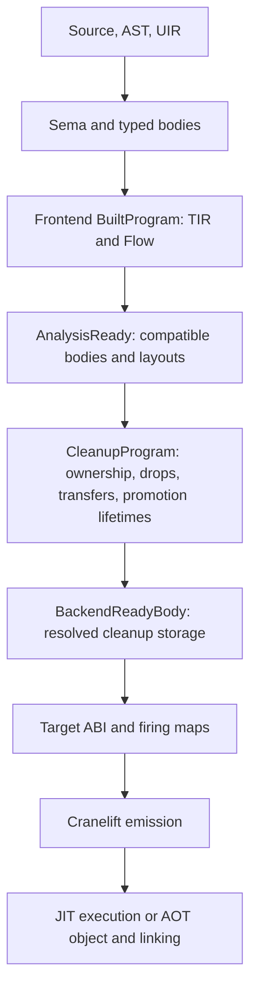
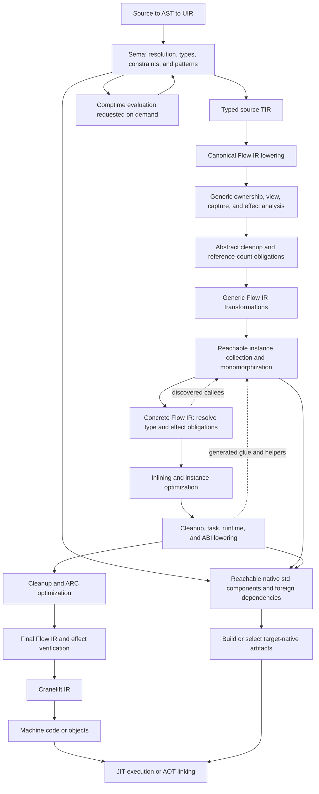
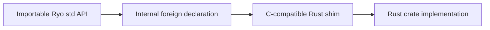

**Status:** Implementation (current Flow migration)

# Compiler Pipeline and Flow IR Migration (Draft — v0.2+)

This document records the current compiler structure, the target pipeline,
and the steps that connect them. The target preserves Ryo's language semantics.
The [roadmap](implementation_roadmap.md) owns feature delivery and milestone status.

## Scope and terminology

UIR is the untyped intermediate representation. TIR is the typed,
source-oriented representation produced by semantic analysis (Sema).
Flow IR is Ryo's typed execution representation. It defines executable control
flow, storage identities, ownership operations, and cleanup before Cranelift.
Use **Flow IR** in documentation and `Flow` in code.
It serves the same architectural role as rustc's mid-level MIR.
The name avoids confusion with a target-specific machine representation.

Just-in-time (JIT) compilation executes generated code in the host process.
Ahead-of-time (AOT) compilation emits a standalone executable.
ABI means application binary interface.

The target keeps flat arenas, compact typed indices, and Cranelift.
Ryo does not need another instruction-selection or register-allocation layer.
Cranelift already provides those services.

The immediate migration covers Flow IR, ownership, cleanup, and backend emission.
Comptime, generics, inlining, shared ownership, and concurrency have later
implementation work. Their boundaries belong in the architecture now.
This document does not authorize new language semantics or syntax.

### Arena structure across stages

Flat arenas and compact typed indices remain the storage principle for Ryo's IRs.
Each representation has a layout suited to its role.
The target does not require every stage to copy Zig's instruction encoding.
Arena storage is compatible with explicit control flow and ownership contracts.

| Stage | Storage contract |
|---|---|
| AST | Typed node arenas, indexed children, and side arenas for lists |
| UIR | Flat untyped instruction arena with indexed operands and side payloads |
| TIR | Per-function typed instruction arena with indexed operands and side payloads |
| Flow IR | Per-function indexed blocks, steps, places, and terminators |
| Ownership and effects | Analysis tables associated with body-local instruction, place, or block identities |
| Comptime | Evaluator frames and allocations with explicit lifetimes; successful results enter interned constant storage |
| Monomorphization | Separate concrete instance bodies with references preserved or remapped under a defined clone/lowering contract |
| Cleanup and optimization | Transform or rebuild Flow arenas while preserving reference validity and invalidating affected analyses |
| Cranelift | Cranelift's own indexed IR and backend representations |
| Linking | Objects, symbols, relocations, and native artifacts |

The current Flow graph is immutable after construction and uses cleanup sidecars.
That implementation does not restrict the target to immutable executable bodies.
Inlining, specialization, and cleanup elaboration need explicit clone and mutation contracts.
Cloning a complete body can preserve local indices, but external identities and
interned references must remain compatible with the destination context.
Combining bodies or rebuilding arenas requires reference remapping or a proved stability rule.
Update side payloads, source provenance, and analysis tables with those references.
Never apply an old side table to a new body merely because its indices fit.
Cached published artifacts remain immutable or explicitly versioned as described below.

## Current pipeline: source audit on 2026-10-15

The current migration implements the supported single-instance pipeline.
Future features in the target pipeline below retain their separate boundaries.
Verification evidence belongs in [pipeline_regression_checks.md](pipeline_regression_checks.md).

The frontend owns Flow construction and ownership analysis in
[`pipeline.rs`](../../ryo-frontend/src/pipeline.rs).
The driver shares these transitions across JIT, AOT, and IR inspection.
Partial artifacts remain inspectable after source errors. Such errors block backend preparation.

Typed bodies, Flow versions, and layout contexts carry process-local identities.
Cleanup records its Flow identity. Backend preparation checks these associations in every build.
Equal names, arena lengths, or valid local indices do not establish compatibility.
Published artifacts expose immutable references. Content stamps also reject edits to cloned
TIR, Flow, and cleanup arenas. Rebuild an artifact and its analyses after a representation change.

[`CleanupPlan`](../../ryo-core/src/flow/cleanup.rs) selects each release's storage before emission.
A binding release names a Flow place. A displaced value release names its producer.
The backend retains declaring-binding storage after lexical name restoration.
Physical fat-value representations also record their declaring binding, which emission checks before destruction.
Aggregate and payload storage follows the same declaring-binding identities.
Promotion scratch allocations have separate identities for each base-expression site.
They share the ordinary cleanup firing maps and the
[shared resolver](../../ryo-core/src/flow/fire_points.rs); no promotion sweep reads representation caches.
Flow records call mutations and view bases. RHS aliasing uses resolved reads and parent metadata.

[`LoweredAbi`](../../ryo-backend/src/codegen/abi.rs) records parameter modes and expansions,
hidden result storage, result convention, target triple, pointer type, and layout context.
Declarations, argument marshalling, callee entry, and return emission consume this description.
Backend preparation rejects incompatible calls before body emission.

Backend caches retain registers, stack addresses, and inline-materialization facts.
They do not choose ownership identities or cleanup positions.
Optional allocation reuse, literal hoisting, range-based guard elision, release elision,
tail calls, and Cranelift optimization can be disabled through the backend test APIs.
Ownership analysis also supplies cleanup without allocation-reuse transfers.

`ryo ir --emit flow` prints existing blocks, steps, terminators, places, source spans,
resolved release storage, transfers, promotion allocations, and validation availability.
The dump uses stage artifacts and the shared resolver. It does not reconstruct execution.

Shared backend literal storage lives in `literals.rs`; scoped lookup lives in `binding_storage.rs`.
Backend preconditions live in `validate.rs`. Frontend ownership transfers live in `transfers.rs`,
aggregate analysis in `aggregates.rs`, cleanup scheduling in `cleanup.rs`,
and materialization diagnostics in `materialization.rs`.

## Why these contracts are required

Structural reachability does not establish execution-path behavior.
An operand walk can discover every instruction without preserving branch
membership, scope, or whether a call actually executes.

The architecture needs four separate contracts:

| Contract | Required information |
|---|---|
| Structural enumeration | Operations, operands, bindings, and projections |
| Control flow | Blocks, successors, backedges, joins, and exits |
| Ownership analysis | Reads, copies, moves, borrows, initialization, and replacement |
| Cleanup lowering | Storage to destroy, its execution path, and its destruction position |

Independent reconstruction of these facts caused missing binding metadata
and incorrect slice-liveness refinement in match expressions.
A common structural visitor alone does not solve those problems.

Earlier audits identified short-circuit, repeated loop-bound, and multi-block elif gaps.
The refreshed builder has conditional logical lowering and records the final elif branch block.
Treat those earlier findings as regression cases, not confirmed defects in the current source.
Validate logical execution, loop preheaders and increments, and multi-block conditions
against the acceptance criteria below before claiming completion.

## Target pipeline

The diagram describes dependencies, not an obligatory sequence of whole-program
passes. Demand-driven queries may request individual bodies or analysis summaries.

Generic bodies remain typed in terms of parameters and declared constraints.
Ownership can distinguish moves from copies without knowing concrete layout.
Destruction obligations can remain abstract until instance lowering resolves them.
The proposed default shares generic analysis across concrete instances.

Type-dependent comptime generation is an exception to ordinary parametric analysis.
If a compile-time result determines a body's structure, Sema must resolve that
structure before checking the affected body. Cache that work explicitly.
Do not make every generic function use early specialization for this exception.

Transformation ordering must respect analysis validity. A pass that changes
calls, storage, exits, or destruction must preserve the relevant facts or invalidate them.
Recompute the affected analyses before their next consumer.
Validation runs at representation boundaries and after structural transformations.

Sema owns module and name resolution, trait and implementation selection,
pattern validation, and exhaustiveness checks. These responsibilities do not
require additional representations or standalone pipeline stages.

### Mandatory lowering and optional optimization

Separate passes required for correctness from optional optimizations.
Ownership validation, cleanup elaboration, required task/runtime lowering,
concrete layout resolution, and ABI lowering run even when optimizations are disabled.
Required comptime evaluation and generic instantiation also remain enabled.

Inlining, ARC elision, devirtualization, and stack promotion are optional.
Their absence must not change accepted programs or documented observable behavior.
Do not depend on an optimization to remove an invalid operation or repair missing cleanup.
Each optional pass declares its prerequisites and the analyses it preserves or invalidates.
If a proof is unavailable, keep the correct unoptimized operation.

Swift's raw-to-canonical SIL transformations illustrate this separation.
Flow IR phase validators must accept the complete unoptimized route to backend-ready code.

### Comparison with Zig and rustc

| Concern | Zig reference | rustc reference | Ryo target |
|---|---|---|---|
| Semantic analysis | Sema analyzes ZIR and produces AIR; comptime participates in analysis | HIR and typed lowering precede MIR analysis | Sema produces source TIR and requests compile-time results |
| Execution representation | Per-function AIR and explicit liveness analysis | MIR with distinct analysis and runtime phases | Flow IR with explicit phase contracts and ownership dataflow |
| Generic code | Comptime arguments participate in Sema specialization | Generic MIR analysis precedes collection of concrete instances | Shared parametric analysis, then reachable instance expansion |
| Constant evaluation | Integrated with Sema | Dedicated MIR queries for constant evaluation | Demand-driven evaluation artifacts separate from runtime optimization |
| Backend boundary | Backend preparation depends on the selected backend | Concrete instance codegen resolves layout and ABI | Backend-ready Flow IR resolves layout, ABI, cleanup, and runtime operations |

These are architectural comparisons, not equivalent language semantics.
Ryo keeps its specified ownership, destruction, and concurrency rules.
The upstream sources below explain the reference implementations.

## Target representation contracts

### TIR and Flow IR

TIR preserves typed source information for lowering and diagnostics.
Flow IR owns execution. Backend code may consult source metadata, but it must not
walk TIR to reconstruct branches, scopes, or cleanup paths.

Flow IR uses explicit basic blocks and terminators. Result-producing branches
transfer values into a defined join result or destination place.
Diverging paths do not contribute a value to that join.

Logical operators need conditional blocks for their right-hand operands. While conditions execute on
backedges. For bounds and induction initialization execute in the preheader.
The loop test and increment have explicit positions.
Conditions can contain their own control flow.

Block allocation order is not a propagation order. Provide graph traversals
and loop convergence. Do not assume one forward scan computes dataflow facts.

### Flow IR phases and validators

Construction validators check Flow structure in debug builds.
Ownership validators check per-path destruction, view protection, displacement,
and promotion pairing in `ownership/validate.rs` and its responsibility-named children.
Their event model uses the same resolved storage that backend emission consumes.
Each promotion allocation has its own discharge group, independent of its borrowed source.
A reseat starts a new generation even when the previous value moved out.

`FunctionSidecar.validation_outcome()` distinguishes unavailable, skipped, incomplete,
and completed checks. Invalid artifact transitions return errors; developer cleanup assertions
reject proven invalid schedules. `proof_complete()` requires all required checks to run
and every not-proved counter to be zero. Source-error gating cannot report a complete proof.
Release builds do not run the expensive developer proof. Their unavailable status remains explicit.
Backend preparation enforces body, representation, layout, position, and ABI contracts in release too.
Debug backend preparation rejects skipped or incomplete cleanup proofs.

Define the following phase boundaries. Phase and specialization are separate:
a body can be generic or concrete independently of its analysis phase.

| Phase | Required contract | Validator rejects |
|---|---|---|
| Built | Explicit execution edges, typed values, places, and source provenance | Invalid references, malformed terminators, missing join inputs, or implicit operand execution |
| Analysis-ready | Ownership transfers, captures, and supported exceptional exits are explicit; symbolic obligations are allowed | Hidden moves, incomplete storage lineage, or exits absent from analysis |
| Cleanup-elaborated | Destruction and join obligations are represented on their required paths; generic drop operations can remain symbolic | Exits that bypass obligations, duplicate destruction, or use after destruction |
| Backend-ready | Concrete types, layouts, calls, ABI, and runtime operations are resolved | Symbolic operations, unresolved callees, abstract drops, or unlowered task operations |

Publish each pass's input phase, output phase, and preserved analyses.
Validate phase transitions and structural transformations. A runtime optimization
must not mutate a cached body used for analysis or constant evaluation.
rustc's MIR phases provide a precedent for defining allowed operations at each boundary.

### Storage and ownership

A place identifies storage independently of the value currently stored there.
Bindings, parameters, temporaries, supported projections, captures, and result
destinations have explicit identities. Names are diagnostic labels.

Represent reads, copies, moves, borrows, initialization, replacement, and
supported payload extraction explicitly. Assignment and `inout` writeback update
storage lineage. Cleanup reads the correct current storage.

Generic operations carry their type and effect obligations.
A `Copy` constraint permits a copy. Otherwise, use the documented move rules.
Do not require concrete layout merely to validate ownership.

Unavailable analysis information is distinct from proven absence.
Missing branch information must preserve a live projection, not remove it.

### Cleanup and backend emission

Ownership establishes validity and destruction obligations.
Cleanup elaboration turns those obligations into operations on executable paths.

Preserve eager destruction for pure-memory values and documented resource lifetimes.
Cover replacements, conditional moves, returns, loop exits, and aggregate joins.
Insert reference-count operations when shared ownership requires them.

Codegen consumes operations and terminators mechanically.
A pending sweep or cached value must not determine ownership validity.
Remove superseded anchor schedules and independent binding-map reconstruction.

### Exceptional exits and cancellation

Distinguish normal return, error propagation, panic, and task cancellation.
For each supported mode, record cleanup edges or an explicit runtime unwind contract.
Calls must declare their normal and exceptional behavior. If a runtime profile
terminates execution for a mode, document that boundary rather than inventing an edge.

No supported exit may bypass a required drop, reference-count release, or scope join.
Join scoped children before destroying parent storage that they borrow.
When a destructor yields during cancellation, retain its continuation and live storage.
Define how cancellation is deferred during cleanup and prevent repeated destruction.
Panic during destruction needs a policy consistent with the specification;
an unspecified policy requires a language-design decision before implementation.
State which behavior applies to each core or hosted runtime profile.

### Concrete layout and ABI lowering

Resolve aggregate size, alignment, field and enum layout, parameter passing,
and return conventions before backend emission. Include hidden result pointers,
`inout` pointers, closure environments, foreign signatures, and runtime layouts.
Call sites and callee declarations must use the same ABI description.

Generic ownership does not require concrete layout. Instance lowering does.
Keep ordinary inlining before ABI lowering so it operates on language-level calls.
If a later pass inlines ABI-lowered bodies, it must preserve that ABI explicitly.
Cranelift provides machine legalization and register allocation; Ryo still owns
the mapping from language storage and calls to backend types and signatures.

### Queries, caching, and invalidation

Use stable declaration and instance identities with explicit dependency tracking.
Query inputs include body contents, generic constraints, implementation selection,
type layouts, comptime inputs, effect summaries, target, runtime profile, and options.
An instance key identifies the request; it does not replace dependency tracking.

Changing a generic body invalidates its instances. Changing an inlined callee
invalidates affected callers. Changing an implementation set can invalidate
resolved calls, effects, and reachable instances. Track any external inputs that
comptime is permitted to read, or reject them under the chosen evaluation contract.

Cache immutable artifacts or explicitly version their phase and analysis results.
After a transformation, preserve proven facts or recompute invalidated analyses
before consumption. Follow the [incremental compilation design](ryo-incremental-compilation.md)
for persistence and scheduling; this migration does not imply that caching is implemented.

### Package metadata and separate compilation

Define a package artifact contract independently of the local query cache.
A downstream compiler needs more than exported symbol names to check calls,
instantiate generics, or optimize across package boundaries.

| Exported information | Downstream use |
|---|---|
| Public declarations, types, constraints, and implementation identities | Name resolution, type checking, and implementation selection |
| Generic bodies with phase and dependency information | Downstream instantiation and validation of cached analysis |
| Eligible inline bodies and their dependencies | Optional cross-package inlining |
| Ownership, capture, and effect summaries | Call analysis without reconstructing an unavailable body |
| ABI descriptions and native dependency manifests | Compatible declarations, artifacts, and final linking |

Persist stable identities and all referenced types and constants.
Version the format and record compiler compatibility, target, runtime profile,
and options wherever they affect an artifact's meaning.
Reject incompatible artifacts or rebuild from available source.
Never reuse a summary after its recorded dependencies change.

Use the same query interfaces for source-built and imported artifacts.
Imported generic bodies enter instance collection; imported inline bodies remain optional.
Public API visibility does not imply that every body must be exported.
Allow lazy decoding so importing one declaration does not load an entire package.
Go's export data provides a precedent for declarations, generic and inline bodies,
and analysis summaries. This contract needs no additional IR.

## Future features and their placement

### FFI and Rust-backed standard library modules

Foreign function interface (FFI) connects generated Ryo code to separately
compiled Rust or C code. Internal runtime calls use this boundary too.
A pure Ryo module uses the ordinary pipeline and needs no FFI.
Static linkage does not remove the foreign calling contract.

Keep essential execution services in the core runtime: allocation, destruction
support, panic handling, and task scheduling where the runtime profile supports them.
Expose library features through importable Ryo std modules.
Select optional Rust implementations from the reachable module and dependency graph.
Do not include every Rust-backed library in every program.
Specialized third-party integrations remain external packages.

The Ryo wrapper defines the public API, ownership behavior, and error translation.
Users of that wrapper do not need foreign declarations at each call site.
User-authored foreign declarations serve direct foreign-library integration.
This structure extends the [std design](std.md) and [Rust wrapper plan](std_ext.md).
Importable modules can use statically linked implementations. Import does not imply dynamic loading.

#### Compiler and memory contracts

| Boundary | Responsibility |
|---|---|
| Sema | Resolve foreign declarations and validate supported types, representations, and calling conventions |
| Ownership and effects | Describe input borrows, ownership transfer, retained storage, callbacks, blocking, and thread affinity |
| Flow IR and cleanup | Represent foreign calls, conversions, and foreign-resource destruction explicitly |
| ABI lowering | Match target layouts, parameter and return conventions, and callback signatures |
| Driver and linking | Select native components, supply dependencies, and resolve symbols for JIT and AOT |

Use C-compatible exported shims rather than Rust ABI calls.
Rust's ABI has no stability guarantee. Keep Rust `String`, `Vec`, and trait objects
inside the Rust component. Exchange defined records, pointer/length pairs, or opaque handles.
Do not assume that a Ryo representation matches a Rust representation.

Specify who owns each buffer or handle, whether a call retains it, and how long
returned borrowed storage remains valid. Each allocation needs a matching destruction
operation from its owning component. Register that operation in Flow IR cleanup.
Callback contracts include environment lifetime, unregistration, calling thread,
and reentrancy. An opaque handle does not by itself establish thread safety.

Translate expected foreign errors into the wrapper's documented error type.
Define whether unexpected Rust panics are caught inside the shim or abort execution.
Do not permit unwinding across a boundary without explicit ABI and cleanup support.
Panic catching cannot recover an aborting panic strategy.
Blocking calls must participate in scheduling and cancellation contracts.
An offloaded call cannot release borrowed storage while the native work still uses it.

Rust compiles its own generic implementations and macros.
Ryo monomorphizes Ryo wrappers. Export concrete shim entry points.
Do not infer foreign-call ownership or effects from a signature alone.
Require an explicit contract or conservatively preserve the affected storage and effects.

#### Native artifacts and dependency selection

Build or select native artifacts before final linking or JIT registration.
Cargo and rustc compile Rust components. The Zig linker does not compile Rust crates.
Cross-compilation needs compatible Rust targets, native dependencies, and target ABI settings.

For static builds, compose selected Rust dependencies through one coordinated
`staticlib` build. Avoid independent archives that duplicate Rust runtime symbols.
Do not pass Rust `rlib` artifacts directly to the foreign linker.
Supply required system libraries and platform linker options explicitly.
The [Rust linkage reference](https://doc.rust-lang.org/reference/linkage.html)
describes these artifact constraints.

Record native dependencies in an emission manifest alongside reachable Ryo instances.
Include component versions, features, target, runtime profile, ABI version, and
build options in artifact dependencies and cache validity.
For JIT, define a host-native loading or registration path and keep loaded code alive
until calls, callbacks, and foreign-resource cleanup finish.

Select components by dependency reachability and use linker removal of unused code
where supported. Verify omitted modules through artifact and size comparisons.
Do not assume an unused import or static archive guarantees zero binary cost.
Core profiles must reject components whose allocation or hosted-runtime needs they cannot support.
No additional IR is required for this integration.

### Comptime

Sema requests compile-time results when they determine types, declarations,
constraints, or selected code. The evaluator returns interned values or diagnostics.

Sema can need a result before it can finish typing another body.
If the evaluator uses Flow IR, request an independently typed evaluator body
on demand. Do not require the requesting body, or the whole runtime pipeline,
to finish first. Track dependencies and diagnose evaluation or typing cycles.
This resolves the apparent Sema-to-Flow-to-Sema dependency in the diagram.

Give evaluator artifacts their own eligibility and validation contract.
They may share lowering with runtime bodies, but must not depend on runtime
inlining, ABI lowering, or optimization that removes evaluation information.
An initial implementation can support a restricted evaluator subset;
its unsupported cases must produce explicit diagnostics.

Define permitted operations, recursion and work limits, target arithmetic and
layout semantics, and evaluator memory lifetime. Convert successful results
into immutable interned constants. References inside those constants must refer
to retained constant storage, never temporary evaluator allocations or host pointers.
Ordinary runtime constant folding remains a separate optimization.
Zig's Sema integration and rustc's separate constant-evaluation MIR queries
are useful precedents for this demand-driven boundary.

### Generics and monomorphization

Check ordinary generic bodies against their declared constraints.
Keep symbolic types and abstract operations in generic Flow IR.
Collect reachable concrete instances with an expanding worklist.

Cache instances by declaration identity, type arguments, and relevant comptime values.
Resolve concrete layouts, calls, drop operations, and effect obligations per instance.
Do not repeat generic ownership analysis unless specialization changes its assumptions.

Start from entry points, exports, and other required roots. Include address-taken
callbacks and dynamic implementations where the language requires them.
Resolving calls and lowering cleanup can discover additional instances:
closure bodies, destructor glue, runtime shims, and functions referenced by statics
or constants. Feed those discoveries back into collection until it reaches a fixed point.

Deduplicate requests by instance identity. Distinguish queued, in-progress,
completed, and failed requests. Ordinary recursive calls reuse an instance;
unbounded type or comptime expansion needs a limit and a diagnostic.
Before emission, every required callee and helper must have a resolved declaration
and an emission plan. One scan before cleanup lowering cannot establish this closure.

The design borrows rustc's generic-analysis boundary without adopting Rust's
lifetime annotations or destruction timing. Generic Flow IR and late monomorphization
are architectural targets. The roadmap still owns their implementation schedule.

### Inlining and optimization

Inlining substitutes a callee into its caller. Monomorphization substitutes
generic arguments into a function instance. Neither operation requires the other.

Permit transformations on generic Flow IR where their proofs are valid.
Use concrete instance information for later inlining and optimization.
Preserve ownership and cleanup contracts, or rerun affected analyses.
Apply growth budgets and measure compile time, allocations, and binary size.

Automatic reference counting (ARC) optimization follows explicit retain/release
insertion. Rebase the existing [ARC design](arc_optimizer.md) onto Flow IR when implemented.
Its current TIR placement describes the earlier pipeline.

### Escape analysis and allocation placement

Ownership analysis establishes whether storage use is valid.
Escape analysis asks whether storage or a reference can outlive a proposed allocation region.
These analyses have different purposes. Escape analysis does not relax ownership rules.

Add escape analysis as an optional Flow IR optimization after required ownership checks.
Use it to consider stack allocation of temporary buffers, closure environments,
and other eligible allocations. Define placement for each transformation relative
to specialization and inlining, since both can expose more precise call behavior.

Track returns, captures, task transfers, shared storage, and foreign calls that retain inputs.
Use declared call summaries or analyze available bodies.
Unknown callees and foreign retention contracts prevent promotion without another valid proof.
A scoped task's join can bound a lifetime, but suspension still needs valid backing storage.

Promotion must preserve destruction timing, address identity where observable,
and every supported exit. Do not move storage to a stack frame that can end before its users.
After calls, captures, or storage change, invalidate escape results or update them with a proof.
Keep the existing allocation when promotion cannot be proved.
Measure allocation counts, execution time, compile time, and stack usage before claiming a benefit.

### Concurrency and parallelism

Closure lowering constructs explicit environments and capture operations.
Ownership checks task transfers and scoped borrowed captures.
A scoped child's borrowed capture protects its owner until the scope join.

The [concurrency implementation plan](concurrency.md) proposes inferred yield effects.
Compute function summaries over the call graph, including recursive cycles.
Keep generic summaries parametric and resolve concrete implementations when known.
Include implicit destructor calls. Recheck effects after transformations that change calls.
Proposal-only restrictions still require their language-design approval.

Cleanup must account for cancellation and scope exits before runtime lowering.
The specification permits destructors to yield during cancellation cleanup.
The compiler/runtime contract must preserve live storage and complete required joins.

Native concurrency uses the planned stackful runtime.
A Rust-style async state-machine transformation is not a native requirement.
Task creation, suspension, channels, joins, and cancellation lower through explicit runtime operations.

Parallel collection APIs do not need a specialization per worker or thread.
Worker count is normally a runtime scheduling choice.
Compiler parallelism is separate: query scheduling, intern-pool synchronization,
and analysis ownership inside the compiler.

## Migration steps and acceptance criteria

| Step | Work | Exit condition |
|---|---|---|
| 1. Establish the baseline | Snapshot current behavior, diagnostics, allocations, and affected benchmarks | Reproducible comparisons exist for the PR state and its base |
| 2. Correct execution lowering | Fix short-circuiting, loop initialization/increment, multi-block conditions, and joins; define phases | Flow IR matches observable execution and passes phase validators |
| 3. Establish places and operations | Replace name-based identity and hidden token conventions with explicit storage and transfers | Shadowing, replacement, payloads, and `inout` have complete lineage |
| 4. Migrate ownership and views | Analyze Flow IR blocks and edges, with branch joins and loop convergence | Ownership no longer reconstructs executable control flow from TIR |
| 5. Elaborate cleanup | Materialize destruction and joins on normal and supported exceptional paths | No exit bypasses a live obligation; destruction is not duplicated |
| 6. Migrate codegen | Resolve concrete layout and ABI, then map backend-ready Flow IR to Cranelift | Calls and callees agree; backend control emission and cleanup follow Flow IR exclusively |
| 7. Remove adapters | Delete redundant walkers, schedules, binding reconstruction, and obsolete guards | One authoritative execution model remains |
| 8. Prepare symbolic analysis | Add parameter types, constraints, abstract operations, and parametric effects | Generic bodies can be checked without concrete layouts |
| 9. Add comptime and instances | Implement independent evaluator queries, cycle checks, fixed-point collection, and dependency-aware instance caching | Constants retain valid storage; all required instances and generated helpers are resolved |
| 10. Add transformations | Implement bounded inlining, cleanup optimization, ARC, and eligible allocation promotion | Optional passes preserve semantics; analysis invalidation is correct; performance gates pass |
| 11. Add concurrency integration | Implement captures, task checks, effects, cancellation cleanup, and runtime lowering | Joins protect borrowed storage; yielding cleanup resumes without duplicate destruction |
| 12. Add foreign and native std integration | Implement foreign contracts, optional Rust shims, native manifests, and JIT/AOT dependency resolution | ABI and destruction agree across languages; excluded std components do not become mandatory dependencies |
| 13. Add package artifacts | Export versioned declarations, required bodies, analysis summaries, ABI, and dependency metadata | Source and artifact imports agree; downstream instantiation works; stale or incompatible artifacts are rejected or rebuilt |

Steps 2–7 complete the current architecture migration.
Steps 8–13 extend that architecture for future features.
Symbolic types and explicit effect/cleanup boundaries must remain possible during the earlier steps.
Step 6 validates existing runtime calls. Step 12 extends that boundary to general FFI
and optional native modules. Feature sequencing remains owned by the roadmap.

Do not remove an unsupported-feature diagnostic until its protected operation works.
A payload result must receive a controlled diagnostic until transfer and destruction are correct.
Representation changes do not authorize new view escapes or partial moves.

Validate the migration with debug and release builds, JIT and AOT execution,
and the Linux address-sanitizer and Valgrind suites.
Cover match placement, nested conditions, short-circuiting, loops, shadowing,
views, payload ownership, and `inout` replacement.
Add supported exceptional-exit cleanup and call/return ABI cases.
For future features, test comptime dependency cycles and constant storage lifetime,
recursive instance expansion, generated helper discovery, and cache invalidation
after body, implementation, target, and option changes.
For native modules, cover buffer and handle destruction, error and panic boundaries,
callback lifetime, retained inputs, blocking calls, and JIT symbol lifetime.
Check target ABI compatibility, missing-symbol diagnostics, and builds with optional modules excluded.
Run required lowering with optional optimizations disabled.
Compare optimized and unoptimized behavior for destruction order and supported exceptional exits.
For escape analysis, cover returned storage, escaping callbacks, scoped tasks,
retained foreign inputs, and invalidation after inlining.
For package artifacts, compare source and artifact imports across a package boundary.
Cover generic instantiation, optional inline bodies, missing summaries, and compatibility rejection.
Change an exported body or effect summary and check downstream invalidation.
Run Miri when runtime changes require it.

Run workspace tests, formatting, Clippy, and the file-length gate.
Compare match-free workloads, increasing arm counts, and large functions.
Use CodSpeed for the performance gate. Do not promise a speedup without measurements.

## Completion definition

The migration is complete when Flow IR defines execution, ownership analyzes Flow IR,
cleanup is explicit, and codegen follows Flow IR.
Phase validators enforce that boundary, including concrete layout and ABI.
Every supported exit satisfies its destruction and join obligations.
These requirements hold with optional optimizations disabled.
TIR remains available for lowering and diagnostics.
A renamed graph beside the old walkers does not satisfy that definition.

Record genuine remaining work through the repository issue helper.
Do not declare completion by moving the core migration into follow-up issues.
Update architecture references after the relevant consumers migrate.

## References

- Spec: [Section 5](../specification.md#5-memory-management-ownership-lite) (ownership, views, destruction, and shared values).
- Spec: [Section 6](../specification.md#6-functions--closures) (functions and captures), [Section 8](../specification.md#8-traits-behavior) (traits).
- Spec: [Section 9](../specification.md#9-concurrency-model-taskfuturechannel) (tasks, cancellation, and joins).
- Spec: [Section 14](../specification.md#14-standard-library) (stdlib layering), [Section 4.11](../specification.md#411-ffi--c-interoperability) and [Section 17](../specification.md#17-ffi--unsafe) (foreign integration).
- Dev: [Standard library foundation](std.md), [Rust-backed std extensions](std_ext.md), and [official native packages](official_pkg.md).
- Spec amendments: [Memory model](ryo-slicing-and-memory-model-final-spec.md), especially scoped task borrows and runtime profiles.
- Dev: [Pipeline alignment](pipeline_alignment.md), [pattern matching](pattern_matching.md), [concurrency](concurrency.md), [closure representation](closure_representation.md), [ARC optimizer](arc_optimizer.md).
- Contributor rules: [Compiler instructions](ryo-compiler-llm-instructions.md).
- Milestones and delivery: [Implementation roadmap](implementation_roadmap.md).
- Dev: [Incremental compilation](ryo-incremental-compilation.md) for queries, dependency tracking, and cache validity.
- Zig: [AIR](https://github.com/ziglang/zig/blob/master/src/Air.zig) and [liveness](https://github.com/ziglang/zig/blob/master/src/Air/Liveness.zig) for arena-based representation and explicit branch analysis.
- Zig: [Sema](https://github.com/ziglang/zig/blob/master/src/Sema.zig) for integrated comptime evaluation and specialization; [AIR legalization](https://github.com/ziglang/zig/blob/master/src/Air/Legalize.zig) for backend preparation.
- rustc: [MIR](https://rustc-dev-guide.rust-lang.org/mir/index.html), [dataflow](https://rustc-dev-guide.rust-lang.org/mir/dataflow.html), [drop elaboration](https://rustc-dev-guide.rust-lang.org/mir/drop-elaboration.html), and [monomorphization](https://rustc-dev-guide.rust-lang.org/backend/monomorph.html) for analysis boundaries and explicit operations.
- rustc: [MIR phases](https://doc.rust-lang.org/nightly/nightly-rustc/rustc_middle/mir/enum.MirPhase.html) and [MIR passes and queries](https://rustc-dev-guide.rust-lang.org/mir/passes.html) for phase-specific contracts and separate evaluator artifacts.
- rustc: [Constant evaluation](https://rustc-dev-guide.rust-lang.org/const-eval.html), [instance collector](https://doc.rust-lang.org/nightly/nightly-rustc/rustc_monomorphize/collector/index.html), [backend lowering](https://rustc-dev-guide.rust-lang.org/backend/lowering-mir.html), and [incremental queries](https://rustc-dev-guide.rust-lang.org/queries/incremental-compilation.html) for evaluation, reachability, ABI, and dependency tracking.
- Rust: [Foreign ABIs](https://doc.rust-lang.org/reference/items/external-blocks.html), [linkage](https://doc.rust-lang.org/reference/linkage.html), and [FFI contracts](https://doc.rust-lang.org/nomicon/ffi.html) for shims, artifacts, callbacks, and unwinding.
- Go: [Compiler architecture and export data](https://go.dev/src/cmd/compile/README) for package artifacts, call summaries, and escape analysis.
- Swift: [Compiler architecture](https://www.swift.org/documentation/swift-compiler/) for mandatory SIL transformations separated from optional specialization and ARC optimization.
