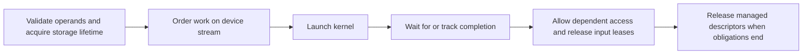

**Status:** Design (v0.2+)

# Tensor Integration: DLPack Wrapping Strategy (Draft — v0.2+)

This proposal describes a typed Ryo wrapper around externally managed tensor storage.
Ryo compiles host code. Native components execute accelerated operations through
a foreign function interface (FFI). DLPack describes exchanged tensor data;
it does not compile kernels or define the complete execution contract.

The [roadmap](implementation_roadmap.md) owns delivery status.
The [pipeline migration](pipeline_migration.md) defines compiler boundaries.
Tensor API names below are illustrative proposals, not additions to the language specification.
JIT means just-in-time execution. AOT means ahead-of-time compilation.

---

### 1. DLPack: Representation and Exchange Contracts

Bind the selected DLPack header through the specified C-header workflow.
Generated declarations use `#[repr(C)]` and exact C field widths.
Do not substitute Ryo `int` for C `int32_t` or handwrite a partial ABI struct.
Current headers use `DLDevice`, rather than the older `DLContext` name.
ABI means application binary interface.

| Metadata | Consumer responsibility |
|---|---|
| Device type and device ID | Select a compatible backend; distinguish host-accessible storage from device-only storage |
| Dtype code, bits, and lanes | Check compatibility with `Tensor[T]`; reject unsupported element representations |
| Rank and shape | Check supported rank, nonnegative dimensions, and checked size calculations |
| Strides and byte offset | Preserve layout and use checked address calculations |
| Managed descriptor and deleter | Track release responsibility independently of underlying storage ownership |
| Version and flags | Validate the selected ABI and supported mutability/copy semantics |

Pin the supported DLPack version and define any legacy compatibility path.
Use `DLManagedTensorVersioned` for the versioned exchange path.
Do not reinterpret a legacy descriptor as a versioned descriptor.
Check version compatibility before reading fields whose layout depends on that version.

Stride handling is version-dependent. Before DLPack 1.2, null strides can indicate
contiguous data; version 1.2 requires strides for nonzero rank.
Zero-rank and zero-size tensors need separate handling.
Read metadata only from a producer that satisfies the pointer and lifetime contract.
Validation cannot prove an arbitrary foreign pointer names a valid allocation.
These requirements follow the [DLPack C API](https://dmlc.github.io/dlpack/latest/c_api.html).

---

### 2. The Opaque Wrapper Pattern

Expose a typed tensor API and keep foreign descriptors inside the native integration layer.
Private fields prevent direct descriptor access; constructor checks establish the wrapper's invariants.
Neither generics nor encapsulation alone validates imported storage.

**Illustrative user API:**

```ryo
t: Tensor[f32] = Tensor.zeros([1024, 1024])
```

#### Step A: Define the Internal Import Boundary

Import exact C declarations from the pinned header.
Keep raw-pointer construction internal to the binding layer.
Define import as a fallible operation that checks metadata before publishing a `Tensor[T]`.
Check dtype, device, dimensions, strides, offsets, and supported flags.
Establish whether access is read-only, writable, exclusive, or shared with a foreign producer.
An owning Ryo wrapper does not imply exclusive access to its underlying allocation.

On success, copy or retain metadata under a defined lifetime contract.
Record the descriptor's release responsibility and backend identity.
On rejection, release any responsibility already acquired exactly once.
Do not let invalid metadata leave a partially initialized public tensor.

#### Step B: Define Resource Destruction

The wrapper owns responsibility for releasing its acquired managed descriptor.
The producer can retain ownership of the underlying allocation.
Its deleter can release a reference or other context rather than immediately free device memory.
Do not free producer storage with Ryo's allocator or assume every descriptor uses a separate heap allocation.

Call a non-null producer deleter exactly once when release is due.
If the deleter is null, do not invoke it; follow the negotiated producer lifetime contract.
Prevent duplicated release responsibility when a tensor moves or an exchange descriptor is consumed.
Tensor views and aliases must keep backing storage alive through a defined ownership mechanism.

Custom destruction follows the specification's `Drop` contract:

```ryo
impl Drop for Tensor[T]:
	fn drop(move self):
		self.release()
```

This sketch names an internal `release` helper, not a complete implementation.
The helper handles producer release and outstanding work under the completion contract below.
As a custom resource destructor, release starts at lexical scope exit under spec Section 5.4.
Any cleanup wait or yield must follow the specified runtime profile and cancellation rules.
Do not substitute last-use destruction for this resource lifetime.

#### Step C: Define Access and Addressing

Specify whether an accessor uses multidimensional indices or a logical flattened index.
Validate rank and every index before address calculation.
Reject negative indices under Ryo's documented indexing rules.
For supported byte-addressable elements, calculate:

```text
element_offset = sum(index[d] * stride[d])
byte_displacement = byte_offset + element_offset * element_size
```

Use checked signed arithmetic and validate the producer's supported address range and alignment contract.
Negative strides need an explicit supported-range proof; otherwise reject that layout.
Packed sub-byte or vector-lane formats need dedicated handling rather than scalar pointer casts.
For legacy contiguous metadata, derive strides with checked arithmetic.

For example, shape `[4]` and stride `[2]` place logical index `1` two elements from the base.
A nonzero byte offset shifts the base as well.
Reading `data[index]` does not implement either case.

Direct host loads require host-accessible storage and completed conflicting device work.
Device-only tensors need an explicit backend read or transfer path.
Do not dereference a GPU pointer from generated CPU code.
Empty tensors have no valid element access; scalar tensors need their own rank-zero access rule.

---

### 3. Integration with TileLang and Other Native Backends

A backend adapter defines its callable ABI, supported devices and layouts,
error translation, kernel artifacts, and launch/completion behavior.
Do not assume every TileLang operation exposes the earlier illustrative `call_kernel` interface.
TileLang has backend-specific compilation and invocation adapters.
Bind the selected adapter or supply a narrow C-compatible shim.

Before matrix multiplication, check both operand ranks, compatible dtypes and devices,
inner dimensions, supported strides, and checked output sizes.
Translate native errors through the chosen Ryo API contract.
Keep backend code loaded while calls, descriptors, callbacks, or deleters can still use it.

#### Launch Completion and Storage Lifetime

A host launch can return before the GPU finishes reading inputs or writing outputs.
Keeping arguments alive only until the host function returns is insufficient.
The [DLPack exchange specification](https://dmlc.github.io/dlpack/latest/python_spec.html)
also requires producer/consumer stream coordination where applicable.



For a synchronous wrapper, wait for required completion before ending temporary input borrows.
For an asynchronous wrapper, retain storage through a completion object or backend lifetime mechanism.
The public asynchronous API requires its own design approval; this document does not introduce one.
Include input reads, output writes, foreign aliases, and cross-stream dependencies in the contract.

Cancellation of a Ryo task does not prove cancellation of native device work.
Preserve storage until completion or a backend-confirmed cancellation makes release valid.
Define completion-error handling and cleanup behavior on every supported exit.
Do not invoke a deleter merely because an event was submitted or a host scope ended.
If the producer defers release itself, document and validate that guarantee in the adapter.

Cancellation cleanup can exceed `unwind_deadline` and force-terminate its task under spec Section 9.
Storage lifetime must therefore survive termination of the launching task and its cleanup continuation.
Before launch, obtain a backend-held storage reference or another independent lifetime guarantee.
Keep that guarantee until device completion or confirmed native cancellation.
Do not rely only on a borrowed parent value, a task-local completion object, or a destructor wait.
If an adapter cannot establish this guarantee, reject the borrowed-storage launch or use independently owned staging storage.
After forced termination, an unreclaimed reference can leak; freeing storage still used by the device is invalid.
Record the completion and eventual release responsibilities in the backend contract.

---

### 4. CPU and GPU Execution Strategy

The target keeps Cranelift for host CPU compilation.
External backends compile and execute GPU kernels.
Ryo does not lower arbitrary Ryo loops into GPU code in this proposal.
Native GPU compilation would require a separate architecture and language design.

| Pipeline boundary | Tensor responsibility |
|---|---|
| Sema and wrapper construction | Check typed APIs; validate dynamic import metadata at runtime |
| Flow IR ownership and effects | Track storage aliases, transfers, foreign retention, and completion-related calls |
| Cleanup and runtime lowering | Materialize release and required completion operations on supported paths |
| ABI lowering | Match descriptors, native call signatures, and backend shims |
| Optional Flow IR optimization | Inline CPU accessors, prove bounds and independence, then vectorize eligible loops |
| Driver, linking, and JIT | Select backend components, kernel artifacts, device requirements, and compatible native dependencies |

#### CPU Optimization

The [experimental vectorization proposal](../experimental/lightweight_vectorization.md)
uses the earlier TIR pipeline. Rebase its transformations onto concrete Flow IR before implementation.
Vectorization needs supported target SIMD operations, proven memory dependencies,
compatible strides and alignment, and correct scalar tails and bounds behavior.
SIMD means single instruction, multiple data.
Contiguous indexing alone does not prove non-aliasing.
Preserve language arithmetic and floating-point semantics.
Keep a correct scalar path when proofs or target support are unavailable.

Vectorization is optional. Tensor correctness must hold with inlining and optimization disabled.
Measure execution time, compilation cost, allocations, transfers, and synchronization.
Do not promise instant compilation or automatic speedups.

#### Backend Packaging and Caching

Tensor APIs can be importable std modules or external packages under the package design.
Select accelerated implementations as optional native components rather than mandatory core runtime dependencies.
The [Mojo backend experiment](../experimental/mojo_tensor_backend.md) describes another possible adapter.
Its illustrative ABI and lifetime assumptions need the same contracts defined here.

Kernel artifacts remain products of the external compiler.
Track backend version, kernel source/artifact identity, target device architecture,
features, options, ABI, and runtime requirements in native manifests and cache dependencies.
For JIT execution, track loaded-module lifetime.
For AOT builds, resolve required libraries and artifact packaging.
Follow the [incremental compilation design](ryo-incremental-compilation.md).
Device dispatch does not require an additional Ryo IR for this host-orchestrator design.

---

### 5. Acceptance Criteria

Use conforming mock producers and backend adapters before relying on hardware tests.

- Import compatible metadata; reject dtype, version, rank, flag, and device mismatches through the defined error path.
- Cover rank-zero, empty, contiguous, strided, and offset tensors, negative indices, and arithmetic overflow.
- Verify unsupported negative-stride and packed layouts receive controlled errors.
- Count producer releases across moves, aliases, failed imports, and supported exceptional exits; no release occurs twice.
- Cover null deleters under their producer lifetime contract and callbacks into retained backend code.
- Delay native completion after launch returns; verify inputs and outputs remain valid until required work finishes.
- Cover cross-stream ordering, cancellation during work, completion failures, and cleanup that waits or yields.
- Force a cancellation cleanup deadline while a kernel still reads borrowed parent storage; let the parent scope exit.
  Verify the backend retains valid storage independently of both scopes until native work completes.
- Verify device-only access uses a backend operation or transfer instead of a host dereference.
- Compare optimized and scalar CPU behavior, including overlapping storage and loop tails.
- Verify builds without tensor modules omit optional backend dependencies.
- Change a kernel, backend ABI, target, or build option; verify cached native artifacts are invalidated.

Run JIT and AOT integration coverage and available device tests for supported backends.
Use host memory-checking tools for host lifetimes and backend/device tools for device behavior.
Do not claim that host-only tests prove GPU lifetime or synchronization correctness.

## References

- Spec: [Section 4.11](../specification.md#411-ffi--c-interoperability) (C-header integration), [Section 5.4](../specification.md#54-hybrid-eager-destruction--raii-drop-trait) (resource destruction), and [Section 9](../specification.md#9-concurrency-model-taskfuturechannel) (tasks and cancellation).
- Dev: [Pipeline migration](pipeline_migration.md), [incremental compilation](ryo-incremental-compilation.md), [Rust-backed std extensions](std_ext.md), and [closure representation](closure_representation.md).
- Experiments: [CPU vectorization](../experimental/lightweight_vectorization.md) and [Mojo tensor backend](../experimental/mojo_tensor_backend.md).
- Delivery: [Implementation roadmap](implementation_roadmap.md).
- DLPack: [C API](https://dmlc.github.io/dlpack/latest/c_api.html) and [exchange specification](https://dmlc.github.io/dlpack/latest/python_spec.html) for representation, release, and stream contracts.
- TileLang: [Targets](https://www.tilelang.com/get_started/targets.html) and [invocation adapters](https://tilelang.com/autoapi/tilelang/jit/kernel/index.html) for external backend compilation and execution.
